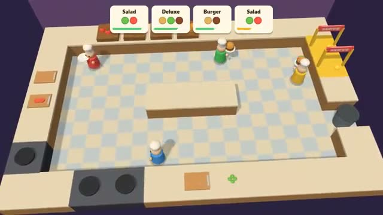

# Kitchen Chaos

Chop, cook and serve before orders run out. A multiplayer starter game from [Multiplayer Agent](https://multiplayeragent.com): 3D, co-op, 2–4 players, with AI cooks that fill empty seats.

## How it plays

Tickets come in for salads and burgers. Grab from the crates, chop at the board, cook meat on the stove before it burns, stack it all on a plate and serve it at the window. Fast service earns a tip; late tickets cost points. A round lasts 3 minutes.

**Controls:** WASD, Space to grab, put down or serve, hold E to chop. On a phone: drag to walk, GRAB and CHOP buttons.

## Make it yours in the Game Builder

Open the [Game Builder](https://multiplayeragent.com), choose **Start from a starter game** and pick Kitchen Chaos. It opens as version 1 in your studio, ready to play and publish. Then ask for changes, for example:

- Add a fire you put out with an extinguisher
- Add a level where the counters move
- Turn it into a pizza shop

## Run it yourself

1. Get a free publishable key (`pk_…`) at [multiplayeragent.com](https://multiplayeragent.com).
2. In `index.html`, put it in place of `pk_REPLACE_ME` in the `MP_CONNECT` block.
3. Serve the folder (for example `npx serve`) and open it. The 3D engine loads as a module, which browsers block from a file on disk.

Without a key it still runs, offline with AI cooks.

## How it is built

- One `index.html` plus three.js in `libs/`. The comment at the top of the script maps the code and explains the multiplayer. The kitchen layout and the recipes are plain text in `CONFIG`.
- **Host-run rules:** The host's browser keeps every ingredient, timer, ticket and the score; if it leaves, the next player takes over.
- **Leaderboard:** The team's score at the end of a round.
- **Bots:** AI cooks pick up the next job the tickets need until enough people join.
- **Live sync:** Everyone sees the same kitchen, every chop and every sizzle.
- `?attract` runs it offline with AI cooks only. The preview video is recorded from it.

## License

MIT. three.js in `libs/` is MIT too (Copyright 2010-2024 three.js authors).
